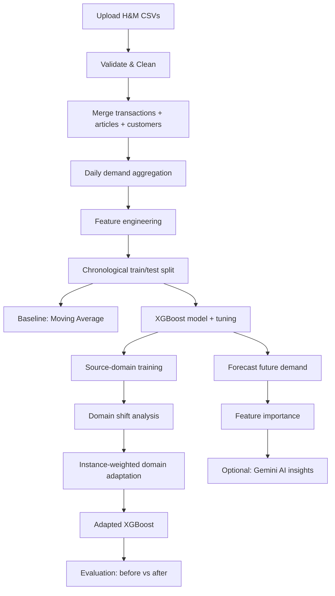

# Fashion Demand Forecasting Using Machine Learning and Domain Adaptation

A Streamlit web application for a final-year B.Tech project. Forecasts
daily product-level demand from the H&M Fashion dataset using XGBoost,
and demonstrates **domain adaptation** — adapting a model trained on one
retail "domain" (e.g. a sales channel) to perform better on a different,
distribution-shifted domain.

---

## 1. Problem Statement

Retailers need to forecast how much of each product will sell on future
days to manage inventory, pricing, and supply chains. A model trained on
historical data from one context (e.g. one sales channel, store type, or
time period) often performs worse when applied to a different context
whose data distribution has shifted — a challenge known as **domain
shift**. This project builds a demand forecasting pipeline and a
practical domain adaptation method to address that gap.

## 2. Objectives

- Build a full, real (non-demo) ML pipeline for daily product demand forecasting.
- Engineer time, seasonal, lag, and rolling-window features without data leakage.
- Train and tune an XGBoost regression model.
- Quantify distribution shift between a source and target domain.
- Apply instance-weighted domain adaptation and measure its actual effect.
- Present all of the above in an interactive Streamlit dashboard.

## 3. Dataset

The [H&M Personalized Fashion Recommendations dataset](https://www.kaggle.com/competitions/h-and-m-personalized-fashion-recommendations)
(or any similarly structured dataset), consisting of three CSV files:

| File | Key columns |
|---|---|
| `transactions_train.csv` | `t_dat`, `customer_id`, `article_id`, `price`, `sales_channel_id` |
| `articles.csv` | `article_id`, `prod_name`, `product_type_name`, `product_group_name`, `colour_group_name`, `department_name`, `section_name`, `garment_group_name`, ... |
| `customers.csv` | `customer_id`, `age`, `club_member_status`, ... |

Files are uploaded through the app — no local paths are hard-coded.

## 4. System Architecture

```
Streamlit UI (app.py)
        │
        ▼
src/data_loader.py        → upload + validate CSVs
src/preprocessing.py      → clean, merge, data-quality report
src/demand_forecasting.py → daily demand aggregation
src/feature_engineering.py→ time / seasonal / lag / rolling features
src/baseline_models.py    → chronological split, moving average, RF/LightGBM
src/xgboost_model.py      → XGBoost training + tuning
src/domain_adaptation.py  → domain classifier + instance weighting
src/evaluation.py         → RMSE / MAE / safe-MAPE / R², improvement %
src/visualization.py      → Plotly charts
src/gemini_helper.py      → optional AI explanations
```



## 5. Data Preprocessing

- Parses `t_dat` to datetime; drops rows missing essential identifiers.
- Removes non-positive prices and exact duplicate rows.
- Fills missing categorical product/customer attributes with `"Unknown"`
  rather than dropping products.
- Left-joins transactions → articles → customers so no transaction rows
  are lost due to a missing catalogue/customer record.
- Displays a full data-quality report (row counts, missing values,
  duplicates, date range, unique customers/products).

## 6. Feature Engineering

- **Time:** year, month, day, day_of_week, week_of_year, day_of_year,
  quarter, is_weekend, is_month_start, is_month_end.
- **Seasonal (cyclical):** sin/cos encodings of month and day-of-week.
- **Lag:** lag_1, lag_7, lag_14, lag_28 (per article, chronological).
- **Rolling:** rolling_mean_{7,14,28}, rolling_std_{7,28} — computed on
  `shift(1)` values so the current day's own demand is never included.
- **Product:** label-encoded product_type_name, product_group_name,
  colour_group_name, department_name, section_name, garment_group_name.
- **Other:** price, sales_channel_id.

## 7. Chronological Train/Test Split

This is a time-series problem, so we split by **date**, not randomly:
first 80% of dates → train, last 20% → test (ratio configurable in the
UI). A random split would let the model "see the future" during
training and produce misleadingly optimistic metrics. Hyperparameter
tuning uses `TimeSeriesSplit` for the same reason.

## 8. Models

- **Baseline:** historical moving average per product.
- **Optional baselines:** Random Forest, LightGBM (if installed).
- **Main model:** XGBoost Regressor, with optional `RandomizedSearchCV`
  hyperparameter tuning over `n_estimators`, `max_depth`,
  `learning_rate`, `subsample`, `colsample_bytree`, `min_child_weight`.

## 9. Domain Adaptation

**Method: importance-weighted domain adaptation.**

1. Choose a domain-defining column (sales channel, department, etc.)
   and pick a source value and a target value.
2. Train XGBoost on source-domain data only; evaluate on target-domain
   data ("before adaptation").
3. Train a Logistic Regression **domain classifier** to distinguish
   source (label 0) from target (label 1) rows using the feature
   columns (the domain column itself is excluded to avoid trivial
   leakage). Its accuracy indicates how different the domains are.
4. For each source row, compute `weight = p_target / (1 - p_target)`
   from the classifier's probability that the row "looks like" target
   data. Weights are clipped to avoid instability.
5. Retrain XGBoost on source data using these weights via
   `sample_weight`; evaluate again on target-domain data ("after
   adaptation").
6. Report RMSE/MAE/MAPE/R² before vs after, with actual (not assumed)
   percentage improvement.

## 10. Evaluation Metrics

RMSE, MAE, **safe MAPE** (rows with zero actual demand are excluded from
the MAPE calculation and the exclusion count is reported, since standard
MAPE is undefined when actual = 0), and R².

## 11. Dashboard Pages

Home · Data Upload · Data Exploration · Demand Analysis · Feature
Engineering · Model Training · Domain Adaptation · Model Evaluation ·
Demand Forecast · AI Insights · About Project.

## 12. Gemini AI Integration (Optional)

The "AI Insights" page can use Google's Gemini API to explain results in
plain language. Only small, aggregated summaries (metrics, top features,
domain-shift stats) are sent — **never the raw dataset**. The app works
fully without a Gemini API key; the feature simply shows a notice that
it isn't configured.

To enable it:
1. Copy `.streamlit/secrets.toml.example` to `.streamlit/secrets.toml`.
2. Add your key: `GEMINI_API_KEY = "..."`.
3. Never commit `secrets.toml` (it's already in `.gitignore`).

## 13. No-Data-Leakage Checklist

- ✅ Daily demand aggregation only summarizes same-day transactions.
- ✅ Lag/rolling features use `.shift()` before any rolling window.
- ✅ Train/test split is chronological, never random.
- ✅ Hyperparameter tuning uses `TimeSeriesSplit`.
- ✅ Target-domain test data is never used to train the source model.
- ✅ The domain-defining column is excluded from model features so the
  domain classifier can't trivially "read" the answer.

## 14. Installation & Running Locally

```bash
git clone <your-repo-url>
cd fashion-demand-forecasting
pip install -r requirements.txt
streamlit run app.py
```

### How to use it
1. Go to **Data Upload**, upload `transactions_train.csv` and
   `articles.csv` (and optionally `customers.csv`), click **Load & Process Data**.
2. Visit **Data Exploration** and **Demand Analysis** to inspect the data.
3. Go to **Feature Engineering** → click **Build Feature Table**.
4. Go to **Model Training** → train the moving-average baseline and XGBoost.
5. Go to **Domain Adaptation** → choose a domain column and source/target
   values → run the analysis.
6. Check **Model Evaluation** for full comparisons and feature importance.
7. Go to **Demand Forecast** → pick a product and horizon → generate a forecast.
8. (Optional) Use **AI Insights** if you've configured a Gemini API key.

## 15. Deployment (Streamlit Community Cloud)

1. Push this repository to GitHub (data/ and models/ are gitignored).
2. Go to [share.streamlit.io](https://share.streamlit.io), sign in, and
   click "New app".
3. Select your repo, branch, and set the main file to `app.py`.
4. If using AI Insights, add `GEMINI_API_KEY` under the app's **Secrets**
   settings (same format as `secrets.toml.example`).
5. Deploy. Streamlit Cloud installs `requirements.txt` automatically.

## 16. Performance Notes

- Data loading and article/customer parsing are cached with
  `st.cache_data`.
- The Data Upload page lets you cap the number of transaction rows read,
  since the full H&M transactions file is very large.
- Prefer testing with a sample (e.g. 100k–300k rows) before scaling up.

## 17. Future Enhancements

- Add more domain-adaptation strategies (e.g. CORAL, adversarial domain adaptation).
- Per-product SHAP explanations.
- Multi-step (direct multi-horizon) forecasting models.
- Automatic hyperparameter tuning scheduling / experiment tracking.
- Support for additional retail datasets beyond H&M.

---

*Built for academic demonstration purposes. Model outputs, especially
percentage improvements, reflect the actual experiment run on your
uploaded data — no results are hard-coded or assumed.*
