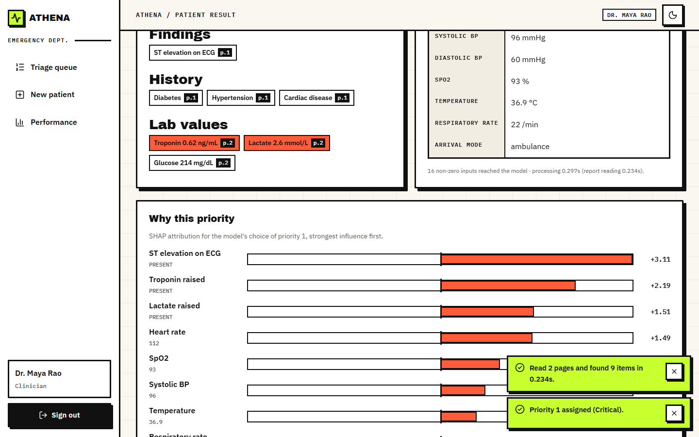

# ATHENA

Emergency triage assistant. It reads a scanned clinical report and the patient's vitals, assigns a priority from 1 (critical) to 5 (non-urgent) with a calibrated confidence, and shows which findings and vitals drove the decision. A clinician accepts or changes the priority and the reason is stored.



## Features
- **Report intake**: PDF or scan in, symptoms, findings, history and lab values out, each with its page
- **Vitals entry** and a **fused record** (report features and vitals side by side)
- **Triage model**: XGBoost, isotonic-calibrated confidence, priority 1 to 5, risk level
- **Why this priority**: per-patient SHAP, strongest factor first
- **Clinician override**: accept or change with a reason, stored as feedback
- **Live queue** ordered by priority then arrival, and a **performance page**

## Quick start
Windows, Python 3.11+, Node 18+:
```
run.bat
```
First run installs everything and trains the model (a few minutes), then opens http://localhost:5307. API on port 8307.

**Demo login:** `clinician@athena.health` / `Athena@123` (also `admin@athena.health`). The login page has one-click buttons.

## Evaluation
Trained and evaluated on a **seeded synthetic dataset** (no real patient data), 1,200 held-out cases:

| Accuracy | Within one level | Macro F1 | Recall P1 to P5 |
|---|---|---|---|
| 69.4% | 99.7% | 0.670 | 44% / 54% / 73% / 72% / 83% |

Report reading on the 12 generated sample reports: precision 100%, recall 100%. Processing time per patient: median 0.02 s for PDFs, 4 to 6 s for image scans (CPU OCR), model alone about 0.01 ms. Details and caveats in [docs/02_HOW_IT_WORKS.md](docs/02_HOW_IT_WORKS.md).

## Documentation
- [docs/01_OVERVIEW.md](docs/01_OVERVIEW.md) what it is and does
- [docs/02_HOW_IT_WORKS.md](docs/02_HOW_IT_WORKS.md) architecture, data, model, API, evaluation
- [docs/03_HOW_TO_RUN.md](docs/03_HOW_TO_RUN.md) running, checks, troubleshooting
- [docs/FRONTEND_PLAN.md](docs/FRONTEND_PLAN.md) frontend inventory and verification

Decision support only. The treating clinician makes the final triage decision.
