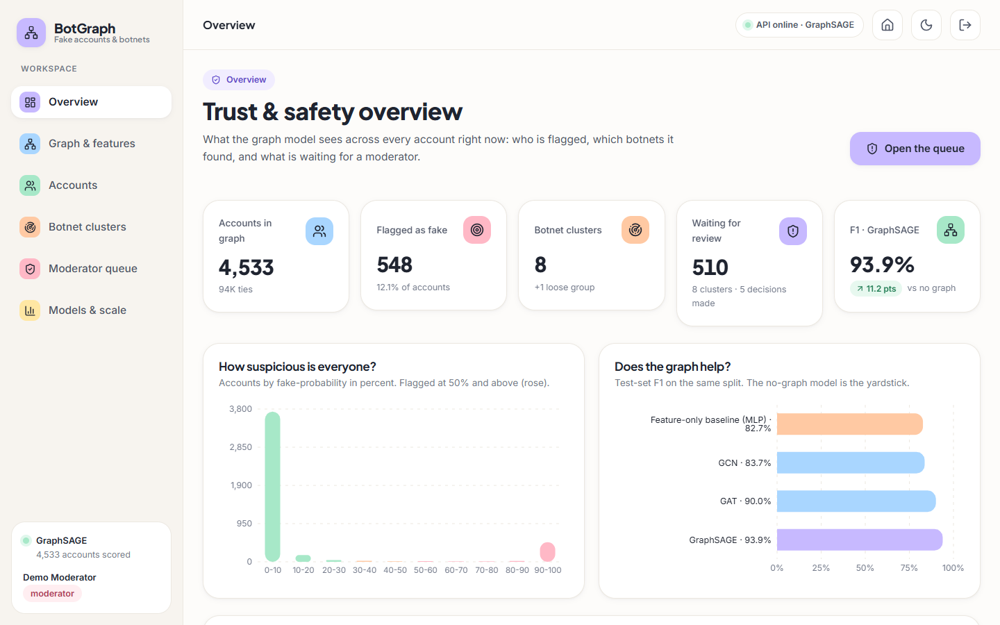

# BotGraph

Finds **fake accounts and coordinated botnets** from the shape of the social graph, not just from single profiles.
Accounts are nodes, interactions are edges; GCN, GAT and GraphSAGE learn from each account's neighbourhood, community
detection over the learned embeddings exposes coordinated clusters, and moderators confirm or dismiss what the model flags.



## Features

- **Graph builder** - real social topology plus labelled profile and posting data in one graph with a documented schema
- **Node features** - 23 features: profile metadata, posting behaviour, timing, interaction frequency
- **Three architectures compared** - GCN, GAT and GraphSAGE against a feature-only baseline, same split
- **Account scoring** - fake-probability, the traits behind it, an interactive neighbourhood graph
- **Botnet clusters** - Louvain over embeddings; size, shared behaviour and a graph view per cluster
- **Moderator queue** - confirm or dismiss an account or a whole cluster; decisions are logged and feed the next training run
- **Evaluation** - accuracy, precision, recall, F1 per architecture, plus a scalability sweep up to 36 thousand accounts

## Quick start

Needs Windows, **Python 3.11+** and **Node.js LTS**.

1. Double-click **`run.bat`** in this folder. The first run installs everything (PyTorch is the slow part).
2. Your browser opens on **http://localhost:5309**. The API runs on port 8309.
3. Sign in with a demo account (the sign-in page fills it for you).

| Demo login | Email | Password |
| --- | --- | --- |
| Moderator (can decide and retrain) | `moderator@botgraph.app` | `Demo@1234` |
| Analyst (read-only) | `analyst@botgraph.app` | `Demo@1234` |

The trained models, scores and clusters are committed, so there is nothing to train before the first start.
Full instructions and troubleshooting: [`docs/03_HOW_TO_RUN.md`](docs/03_HOW_TO_RUN.md).

## Evaluation results

Held-out test split (908 accounts, 114 fake), mean over three training seeds. Fake accounts are 12.6 % of the data.

| Model | Accuracy | Precision | Recall | F1 | ROC-AUC |
| --- | --- | --- | --- | --- | --- |
| Feature-only baseline (no graph) | 0.959 | 0.868 | 0.789 | 0.827 ± 0.010 | 0.967 |
| GCN | 0.964 | 0.958 | 0.743 | 0.837 ± 0.009 | 0.988 |
| GAT | 0.977 | 0.963 | 0.845 | 0.900 ± 0.018 | 0.978 |
| **GraphSAGE** (served) | **0.985** | **0.975** | **0.906** | **0.939 ± 0.006** | **0.990** |

- All three graph models beat the no-graph baseline on F1. GCN's gain is small (+1.0 point); GraphSAGE gains 11.2 points.
- **Botnets:** all 8 injected botnets are recovered as single communities (mean recall 100 %, precision 98.8 %).
- **Scale:** training and inference time grow roughly in proportion to the number of ties; a full GraphSAGE epoch on 36 thousand accounts and 756 thousand ties takes about 0.4 s on CPU.

Raw numbers: `experiments/metrics.json`, `experiments/scalability.json`, `experiments/eval/metrics.json`.

## What is real and what is synthetic

The topology (about 3,960 accounts, 88 thousand ties), the profile rows and the posting rows come from public datasets
(Facebook ego networks, an Instagram fake-account set, a Twitter bot set). The eight botnets, 150 lone spammers, the
timing and interaction features and the handles are **seeded synthetic data**, so cluster detection can be scored against a
known answer. Details and limits are in [`docs/01_OVERVIEW.md`](docs/01_OVERVIEW.md) and [`docs/02_HOW_IT_WORKS.md`](docs/02_HOW_IT_WORKS.md).

## Documentation

| File | Contents |
| --- | --- |
| [`docs/01_OVERVIEW.md`](docs/01_OVERVIEW.md) | The problem, users, features, what is real and what is synthetic |
| [`docs/02_HOW_IT_WORKS.md`](docs/02_HOW_IT_WORKS.md) | Data, graph schema, features, models, clustering, results, moderator feedback |
| [`docs/03_HOW_TO_RUN.md`](docs/03_HOW_TO_RUN.md) | Setup, demo logins, commands, troubleshooting |
| [`docs/FRONTEND_PLAN.md`](docs/FRONTEND_PLAN.md) | API inventory, screen map, verification checklist |
| `docs/screenshots/` | One screenshot per screen (light and dark landing page) |

## Project layout

```
backend/app/     FastAPI app: main.py, db.py, auth.py, routes/, services/
frontend/src/    React app (V4 Soft Pastel Calm kit): pages/, components/, lib/
ml/              graph builder, GCN / GAT / GraphSAGE, training, clustering, evaluation
scripts/         smoke_test.py, capture_screens.py, ui_checks.py, download_data.py
data/            raw/ (public datasets), processed/ (graph + accounts), app.db (created on first start)
models/          trained weights, scores, clusters      experiments/   metrics and scalability results
setup.bat  run.bat  .env.example
```

## Checks

- `scripts/smoke_test.py` - starts its own API on a spare port with a scratch database, drives login, graph, scores, clusters, moderator decisions and retraining.
- `scripts/ui_checks.py` - 360 / 768 / 1440 px in light and dark, dark-mode toggle, keyboard, reduced motion.
- `scripts/capture_screens.py` - walks every screen, saves screenshots and reports any console error.
