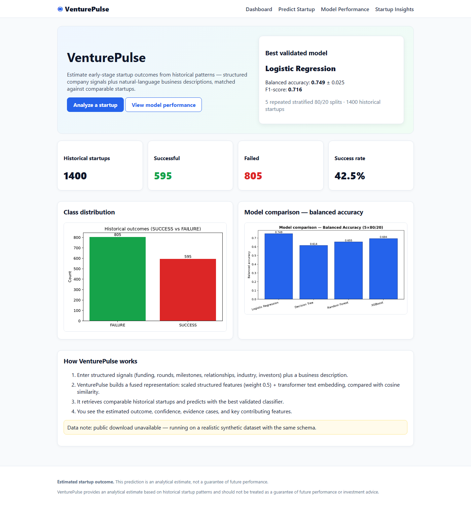

# VenturePulse

**VenturePulse** is a web application that estimates whether an early-stage startup is more likely to reach a **SUCCESS** or **FAILURE** outcome, based on patterns learned from historical startup data. It combines structured company signals (funding, rounds, milestones, relationships, industry, investors) with a natural-language business description, finds comparable historical startups, and predicts with a validated machine-learning model.

> Estimated startup outcome. This prediction is an analytical estimate, not a guarantee of future performance.



## Key features

- **New React frontend (Kinetic Mono)** in `frontend/` - landing page, demo sign-in, dashboard, analyze + result, model performance and insights, all on the same FastAPI backend. The original server-rendered pages still work at `/dashboard`.
- **Startup outcome prediction** from structured inputs + free-text description
- **Similar-case retrieval**: every prediction shows comparable historical startups with cosine-similarity scores, outcomes, funding, industry and summaries
- **Four validated classifiers**: Logistic Regression, Decision Tree, Random Forest, XGBoost — compared with 5 repeated stratified 80/20 splits
- **Fused representation**: scaled structured features (weight α=0.5) + `sentence-transformers/all-MiniLM-L6-v2` text embeddings, cosine similarity
- **Live dashboards**: model comparison, confusion matrix, feature importance, retrieval-size comparison, industry success rates, funding distributions
- **Local-first**: no API keys, no external prediction services; everything runs on localhost

## Actual results (this deployment)

Measured locally with 5 repeated stratified 80/20 splits (balanced accuracy = primary metric), 1400 historical startups (595 SUCCESS / 805 FAILURE):

| Model | Balanced acc. | Accuracy | Precision | Recall | F1 |
|---|---|---|---|---|---|
| **Logistic Regression (selected)** | **0.749 ± 0.025** | 0.751 | 0.696 | 0.739 | **0.716** |
| Decision Tree | 0.614 ± 0.041 | 0.621 | 0.551 | 0.568 | 0.558 |
| Random Forest | 0.641 ± 0.021 | 0.661 | 0.623 | 0.513 | 0.562 |
| XGBoost | 0.697 ± 0.010 | 0.712 | 0.685 | 0.598 | 0.639 |

Representation study (balanced accuracy): structured-only 0.714, text-only 0.599, **combined 0.749** — combining both views helps.
Similar-case weighted vote by retrieval size: k=10: 0.654, k=20: 0.682, k=30: 0.691, **k=50: 0.698** (default k=50).

> The model files were re-trained with `requirements.txt` (scikit-learn 1.5.2 / pandas 2.2.3) when the React frontend was added, because the originally shipped files had been saved with newer library versions and could not be loaded. Logistic Regression is unchanged; the three other rows moved slightly.

## Technology stack

Python, FastAPI, Jinja2, pandas, scikit-learn, XGBoost, sentence-transformers (all-MiniLM-L6-v2), torch, joblib, matplotlib, uvicorn.

## Architecture / ML workflow

1. **Data ingestion** (`app/ml/dataset.py`): loads the public "Startup Success Prediction" CSV when present (`data/raw/`); otherwise generates a realistic synthetic dataset with the same schema and records that fallback in metadata.
2. **Preprocessing** (`app/ml/preprocessing.py`): dedup, target mapping (acquired→SUCCESS, closed→FAILURE), median/most-frequent imputation, StandardScaler numeric, OneHotEncoder categoricals, log-funding feature, description cleaning + company-name masking.
3. **Embeddings** (`app/ml/embeddings.py`): all-MiniLM-L6-v2 (384-d), cached to `models/text_embeddings.npz`.
4. **Fusion + retrieval** (`app/ml/retrieval.py`): L2-normalized blocks fused as `[0.5·s, 0.5·t]`; cosine similarity vs training records only; balanced top-k retrieval.
5. **Training + evaluation** (`app/ml/evaluation.py`): 5× StratifiedShuffleSplit(80/20, seed 42); all four models; representation + retrieval-k studies; charts to `app/static/img/`; artifacts to `models/`.
6. **Serving** (`app/services/`, `app/main.py`): best model by balanced accuracy serves predictions; retrieval supplies evidence; deterministic explanations from coefficients/importance + similarity stats.

## Data source

Public Kaggle dataset "Startup Success Prediction" by Manish KC (CC0/Public Domain): https://www.kaggle.com/datasets/manishkc06/startup-success-prediction — place the CSV in `data/raw/` and restart to use it. If it cannot be downloaded (network/login/API limits), the app automatically uses a realistic synthetic dataset with the same schema; this is documented in metadata, the dashboard data note, and `models/metadata.json`.

## Prediction workflow

Inputs → validation → structured scaling + text embedding → fused vector → cosine retrieval of k comparable startups (balanced) → best-model probability → result page with outcome, confidence, key features, similar cases, explanation.

## Evaluation methodology

StratifiedShuffleSplit, 5 repetitions, 80% train / 20% test, seed 42. Preprocessing fit on train only. Metrics: accuracy, balanced accuracy (primary), precision, recall, F1, confusion matrix — mean ± std. No test leakage: retrieval searches training records only.

## How to run

See **[HOW_TO_RUN.md](HOW_TO_RUN.md)**. Quickest: double-click `run.bat`, then open http://localhost:5410 (React app; the API and the original pages are on http://localhost:8410). Demo sign-in: `demo@venturepulse.com` / `Demo@1234`. Docker: `run-docker.bat` (Recommended if Docker Desktop is installed).

## API overview

- `GET /`, `GET /dashboard` — dashboard
- `GET /predict` — form; `POST /predict` — JSON prediction; form posts to `POST /predict-form`
- `GET /performance`, `GET /insights` — pages
- `GET /api/health`, `GET /api/model-metrics`, `GET /api/insights` — JSON APIs
- `GET /api/config`, `GET /api/feature-importance` — read-only helpers added for the React frontend
- `POST /api/auth/login`, `GET /api/auth/me` — demo sign-in for the React frontend

Example: `POST /predict` with `{"funding_total_usd": 2500000, "funding_rounds": 2, "industry_type": "Software", "description": "...", "k": 50}` → `{outcome, probability_success, confidence, model, similar[...], explanation[...]}`.

## Limitations

- Predictions are probabilistic estimates from historical correlations, not investment advice.
- Descriptions are truncated at 2000 characters; embeddings run on CPU.
- If the public CSV is absent, results reflect the synthetic fallback schema.
- Class imbalance and small-sample industries limit reliability for rare segments.

## Screenshots

In `screenshots/`: dashboard, prediction form, prediction result, similar-startup evidence, model performance, insights — all captured from the running app.

## Project structure

```text
VenturePulse/
├── app/main.py app/config.py
├── app/ml/ (dataset, preprocessing, embeddings, retrieval, models, evaluation)
├── app/services/ (store, predictor, insights)
├── app/api_extra.py (additive endpoints for the React app)
├── app/templates/ app/static/ (original pages)
├── frontend/ (React + Vite, kit V5 Kinetic Mono)
├── data/raw data/processed data/sample
├── docs/FRONTEND_PLAN.md docs/screenshots/
├── models/ evaluation/ screenshots/ scripts/ tests/
├── requirements.txt run.bat run-docker.bat Dockerfile docker-compose.yml
├── README.md HOW_TO_RUN.md VenturePulse_Documentation.pdf
```
