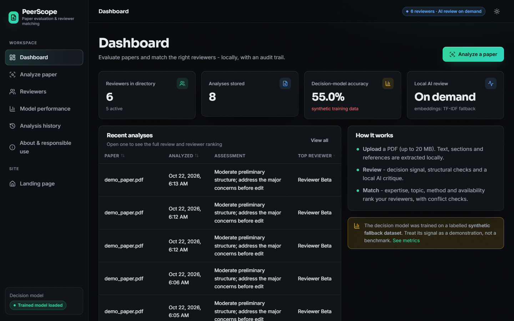

# PeerScope — AI-Assisted Paper Evaluation & Reviewer Matching

PeerScope is a polished local web application that turns a research-paper PDF into a **preliminary assessment** plus **transparent, auditable reviewer recommendations**.

**PeerScope provides AI-assisted analysis and reviewer matching for decision support. Final editorial judgment remains with a qualified human.**



## Features

- **PDF intake** — drag-and-drop upload with extension, type, and size validation (20 MB), safe temp handling, and clear error messages.
- **Local extraction** — PyMuPDF page text, whitespace normalization, section detection (summary, introduction, related work, methodology, experiments, results, discussion, conclusion, references), reference parsing, page-anchored evidence.
- **Trained decision signal** — TF-IDF (word 1–2 + char 3–5) + LogisticRegression classifier trained by `scripts/train_model.py`; real measured metrics shown in-app (never hardcoded).
- **Structural signals** — deterministic, documented indicators (structure completeness, evidence coverage, method clarity, presentation) computed from the uploaded paper.
- **Local AI review** — lazy-loaded Qwen instruction model on CPU with a 3-step pipeline (analyze → critique → synthesize). If the model can't load, the UI says so and keeps the deterministic analysis visible — no fabricated content.
- **Literature grounding** — OpenAlex related-work retrieval with strict timeouts; ranked by semantic similarity; failures degrade gracefully with `literature_retrieval_status = unavailable`.
- **Reviewer directory** — SQLite-backed CRUD, activate/deactivate, CSV import/export, conflict terms, load tracking; ships with clearly-marked demo profiles.
- **Auditable matching** — `final = 0.55·expertise + 0.20·keyword + 0.15·method + 0.10·availability − conflict_penalty` (0–100), every recommendation showing its breakdown, matching terms, and a deterministic explanation.
- **History & export** — stored analyses with JSON and PDF export.
- **Responsible use** — product-wide disclaimers; no claims of replacing reviewers or guaranteeing correctness.

## Architecture

```
PDF → extraction → normalization + section detection → feature extraction
  → trained decision model + structural signals + local LLM review + literature grounding
  → review synthesis → preliminary assessment → expertise matching → auditable ranking
  → dashboard + export
```

| Area | Stack |
|---|---|
| Backend | Python 3.11/3.12, FastAPI, Uvicorn, Pydantic |
| PDF | PyMuPDF |
| ML | scikit-learn, pandas, numpy, joblib |
| Semantics | sentence-transformers `all-MiniLM-L6-v2` (TF-IDF fallback offline) |
| Local LLM | Transformers + PyTorch, `Qwen2.5-1.5B-Instruct` (fallback `0.5B`), CPU, lazy load |
| Literature | OpenAlex public API (no key) |
| Storage | SQLite + SQLAlchemy, local `data/` |
| Frontend | React + Vite (JavaScript), kit V3 "Depth Studio" (three.js hero, framer-motion, GSAP, Recharts) in `frontend/`; the original vanilla UI remains in `static/` |
| Reports | reportlab |

## Installation & Run

See **[HOW_TO_RUN.md](HOW_TO_RUN.md)** for the full guide. Quick paths:

**Automatic (recommended):** double-click **`run.bat`** (needs Python 3.11/3.12 and Node.js 18+), then open **http://localhost:5408**. The API listens on port 8408.

**Docker:**
```
docker build -t peerscope .
docker run --rm -p 8408:8408 peerscope   # API only; start the web app with run.bat or npm run dev
```

**Manual (Windows):**
```
python -m venv .venv
.venv\Scripts\activate
python -m pip install -r requirements.txt
python scripts\prepare_dataset.py
python scripts\train_model.py
python scripts\make_demo_pdf.py
python -m uvicorn app.main:app --host 127.0.0.1 --port 8408
cd frontend && npm install && npm run dev      # web app on http://localhost:5408
```

## Screenshots

Real captures from the running app are in `docs/screenshots/` (`python scripts/capture_screens.py`); the older captures of the original UI are in `screenshots/`:

- `screenshots/01_dashboard.png` — Dashboard
- `screenshots/02_analyze.png` — Analyze screen
- `screenshots/03_results.png` — Analysis results
- `screenshots/05_reviewers.png` — Reviewer directory
- `screenshots/06_model.png` — Model Performance

## Model training & evaluation

```
python scripts/prepare_dataset.py   # public probe, else labeled synthetic fallback
python scripts/train_model.py       # trains, evaluates, saves models/metrics.json
python scripts/evaluate_model.py    # reloads artifacts and recomputes metrics
```

Metrics shown on the Model Performance page come from `models/metrics.json` (accuracy, precision, recall, F1, ROC-AUC, confusion matrix, test count, class distribution, source, timestamp).

## Reviewer matching

Paper and reviewer profiles are embedded, cosine similarity is combined with keyword/method overlap, availability, and conflict penalty. Weights live in `app/config.py` (`MATCH_WEIGHTS`). Every recommendation carries its audit breakdown — rankings are computed live, never hardcoded.

## Responsible use

- AI output can contain errors; scientific validity requires human expertise.
- Recommendations are suggestions; verify conflicts independently.
- Retrieved literature is context, not proof of novelty.
- Never use PeerScope as the sole basis for publication decisions.

## Project structure

```
app/            FastAPI app, config, database, models, schemas
app/api/        (routes consolidated in app/main.py for single-service simplicity)
app/services/   pdf_extract, features, ml_predict, llm_service, literature,
                review_synthesis, matching, pipeline, export_service, seed, embeddings
frontend/       React + Vite web app (src/components kit V3, src/pages, src/lib/api.js)
static/         original vanilla UI (kept as a fallback, served by the API at /)
data/demo/      demo_paper.pdf (generated fixture, clearly demo data)
models/         decision_model.joblib, tfidf_vectorizer.joblib, metrics.json
scripts/        prepare_dataset, train_model, evaluate_model, make_demo_pdf,
                capture_screenshots, build_docs_pdf
tests/          pytest suite (extraction, features, matching, conflicts, ML, API, pipeline)
screenshots/    real app captures
```

## Privacy

PDFs are processed locally. Only title/topic keywords are sent to OpenAlex for literature context. No document is sent to paid APIs; no credentials required.
